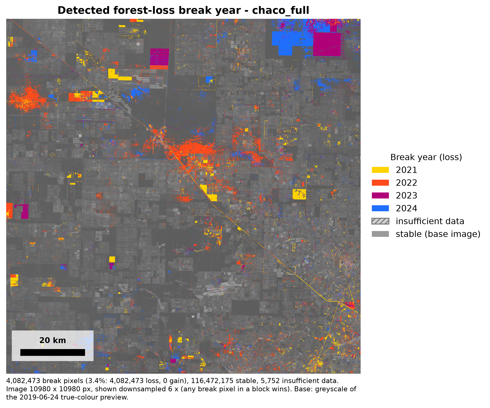
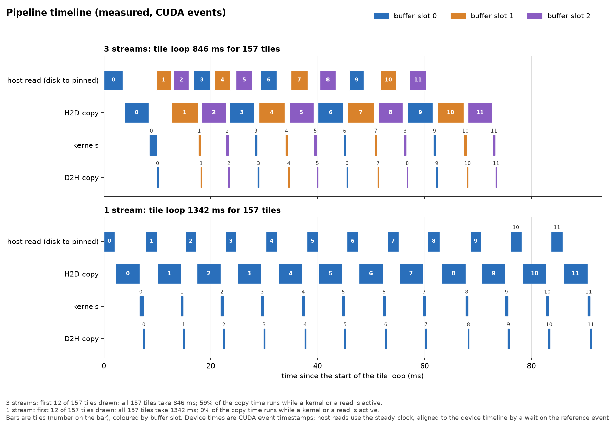
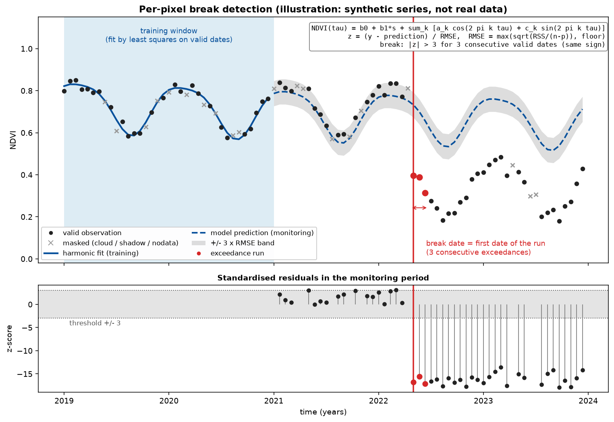
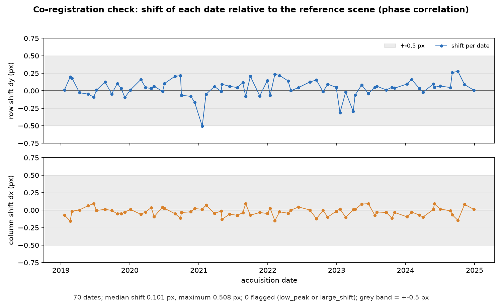
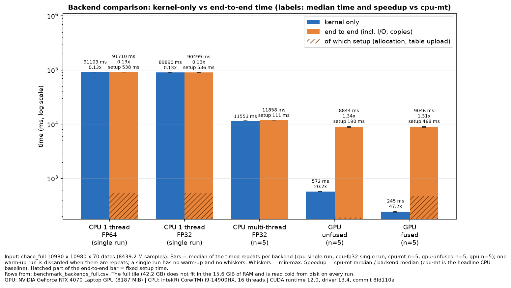

# change_detect: GPU time-series change detection on Sentinel-2 imagery

`change_detect` is a CUDA C++ program that finds, for every pixel of a stack of
satellite scenes, **when the land changed**. Each pixel's NDVI history is an
independent small signal: one GPU thread fits a seasonal regression (trend plus
two yearly harmonics) to the pixel's first two years and then reports the first
run of later observations that the model cannot explain.

**Headline result.** One logged run (`results/logs/log_detect_gpu_10980x10980x70_full.txt`)
processed a full Sentinel-2 tile of the Paraguayan Chaco, 10,980 x 10,980 pixels
x 70 monthly dates (2019-2024): **120,560,400 pixel time series, 8.44 billion
samples, 42.2 GB of raw input**, streamed from disk in 687 tiles, in **11.6 s**
wall-clock time on a laptop RTX 4070 (8 GB). The 120.6 million per-pixel
kernels take 0.26 s of that. Against the Hansen forest-loss reference the map
reaches F1 0.816 (precision 0.809, recall 0.823; scored on the 43.5 M pixels the
reference can judge, see "Validation"). The same tile took 14.1 s on
a 16-thread CPU build (`cpu-mt`) and 98.3 s on one CPU thread (FP64), in single
runs of the same program with the same parameters. In the repeated benchmark
(median of 5, `results/csv/benchmark_backends_full.csv`) the GPU is 47x faster
than `cpu-mt` on the kernels alone and 1.31x faster end to end (backend time,
which excludes writing the outputs; the two single headline runs give 1.22x
wall-clock, 11.6 s vs 14.1 s). The end-to-end time is dominated by reading 42 GB
from disk and copying it over PCIe (see "Where the time goes" below).



*Break year of the detected forest loss over the whole tile
(`results/figures/change_year_map.png`, downsampled 6x).*

## Honest framing

A CPU can do exactly the same computation; nothing here is impossible without a
GPU. The value of the GPU is a **measured reduction in run time on this
hardware** (laptop i9-14900HX with 16 visible threads, RTX 4070 Laptop GPU,
WSL2). The numbers, all from `results/`:

* Kernels only, 5 repeats: the fused GPU kernel is 47x faster than 16 CPU
  threads on the full tile (245 ms vs 11,553 ms) and 42x faster on the 25 M
  series demo cube (50 ms vs 2,097 ms).
* End to end (read, copy, compute, results in host memory): 1.31x faster than
  16 CPU threads on the full tile (9.05 s vs 11.86 s), 1.99x on the demo cube
  (1.08 s vs 2.14 s), and about 10x (full tile, a single run) and 20x (demo)
  faster than one FP64 CPU thread.
* The GPU does not win everywhere: at 1 M pixels the 16-thread CPU is faster
  (`results/csv/benchmark_scaling_pixels.csv`), and on the full tile 91 % of the
  GPU run is spent reading the input from disk.
* Results depend on the hardware; no number here is extrapolated beyond the
  sizes that were measured.

## Quick start

```bash
make            # builds bin/change_detect (GPU build when nvcc is found)
make smoke      # builds, runs the unit tests and a synthetic run; prints SMOKE: PASS
./run.sh sample # the committed 128 x 128 x 70 real cube; writes out/sample/ with figures
```

`make smoke` needs no data and no network. `./run.sh sample` also needs the
Python helper environment for its figures (`bash scripts/setup_python.sh`).

## Requirements

An NVIDIA GPU with a CUDA toolkit (nvcc 12.0 was used), a C++17 compiler, GNU
make, and for the helper scripts Python 3.10+. Exact versions and per-OS steps
are in [`INSTALL`](INSTALL). The CPU-only program (`make cpu`) needs no GPU.

## Build

| Command | Result |
| --- | --- |
| `make` | GPU program if `nvcc` is found, else the CPU program |
| `make gpu` | `bin/change_detect` (CUDA plus CPU backends) |
| `make cpu` | `bin/change_detect_cpu` (CPU backends only, no CUDA needed) |
| `make test` | build and run the GPU unit tests (`bin/run_tests`) |
| `make test-cpu` | build and run the CPU-only unit tests |
| `make smoke` | installation check: build, tests, synthetic run, `SMOKE: PASS` or `FAIL` |
| `make lint` | `clang-format --dry-run --Werror` (Google style) and `cpplint`; prints `LINT: PASS` |
| `make format` | reformat `src/` and `tests/` in place |
| `make figures FIGURE_ARGS="..."` | `scripts/render_figures.py` with the given arguments |
| `make bench` | the benchmark suite (`scripts/run_benchmarks.sh`) |
| `make proof` | regenerate `results/lint/`, check `results/MANIFEST.md` against the tree and write `proof_of_execution.tar.gz` |
| `make venv` | create `.venv` and install the pinned Python packages |
| `make clean` | remove `build/` and the built binaries |
| `make help` | list the targets |

Variables: `CUDA_ARCH` (default: compute capability of GPU 0 from `nvidia-smi`,
for example `sm_89`, else `sm_75`), `NVCC_CCBIN` (host compiler for nvcc,
default `g++-12` when installed), `BUILD_DIR`, `BIN_DIR`, `VERBOSE_PTXAS=1`
(prints register use per kernel), `PYTHON`. Example: `make gpu CUDA_ARCH=sm_86`.

## Run

```bash
bin/change_detect --help     # full command-line reference
./run.sh help                # documented example runs
```

`run.sh` examples (results and logs go to `out/<example>/`; extra flags are
appended and override the example's flags):

```bash
./run.sh synthetic                 # 2048x2048x48 synthetic cube, GPU, compared with cpu-mt
./run.sh sample                    # committed real sample cube with validation and figures
./run.sh dev                       # 2048x2048x70 development cube (needs the data, see below)
./run.sh demo                      # 5000x5000x70 demo cube
./run.sh full                      # the 10980x10980x70 tile, 42 GB, streamed from disk
./run.sh cpu-baseline demo         # the same input on cpu-mt
./run.sh quick-diff                # two-date NDVI difference
./run.sh live-demo                 # GPU detect plus figures on the dev cube
./run.sh benchmark                 # all benchmark sweeps
./run.sh dev --threshold 4         # override any flag
```

The command of the headline run was:

```bash
./bin/change_detect --input data/cubes/chaco_full/manifest.txt --backend gpu \
    --losses-only --compare-to cpu --output-dir out/full_gpu \
    --log-file out/full_gpu/log_detect_gpu_10980x10980x70_full.txt
```

## How the GPU is used

The problem has the shape GPUs like: the same moderately heavy computation
(a 6-parameter regression fit plus a residual test over every later date) on
120 million independent pixels. The core kernels use one thread per pixel.

### Kernels

All kernels are in `src/cuda/`; every one has a comment with purpose, thread
mapping and memory access pattern. The per-pixel mathematics lives once in
`src/pixel_model.h` as `CD_HOST_DEVICE` templates; the GPU kernels instantiate
it with `float`, the CPU baselines with `double` and `float`, so "the same
algorithm on every backend" holds by construction.

| Kernel | Purpose | Thread mapping | Memory access |
| --- | --- | --- | --- |
| `ComputeNdviKernel` | mask by scene class and no-data, scale, compute NDVI (unfused path) | one thread per (date, pixel), grid-stride loop | coalesced loads of red, nir, scl and store of NDVI; scale and offset from constant memory |
| `FitHarmonicModelKernel` | least-squares fit of trend + K harmonics: normal equations in registers, Cholesky solve, RMSE (unfused path) | one thread per pixel | walks the training dates; adjacent threads read adjacent pixels of a date (coalesced); coefficient-major output (`c * pixels + pixel`) so stores coalesce |
| `DetectBreakKernel` | monitoring state machine: first run of consecutive same-sign exceedances (unfused path) | one thread per pixel | coalesced reads, stride `pixels` between dates |
| `FusedChangeDetectionKernel` | NDVI, fit and detection in one pass straight from the raw bands; the NDVI cube is never stored (default) | one thread per pixel | recomputes NDVI from red, nir, scl in each of three passes over the dates; coalesced |
| `ColorizeChangeMapKernel` | break index to an RGBA colour | one thread per pixel | coalesced reads, one 4-byte store |
| `CleanupKernel` (`--cleanup`) | remove isolated break pixels (3x3 rule) | 32 x 8 block per patch, one thread per pixel | shared-memory tile with a 1-pixel halo |
| `ConfusionKernel` | confusion counts against the reference, computed inside the tile pipeline | grid-stride loop | per-thread counters, warp-shuffle reduction, shared-memory reduction, one `atomicAdd` per counter per block |
| `QuickDiffKernel` | two-date NDVI difference (`--mode quick-diff`) | one thread per pixel | six coalesced reads, two writes; memory bound |

All launches use `const`, `__restrict__` pointers and 64-bit indices; the small
fixed-size loops are unrolled (`#pragma unroll`). `--block-size` is a run-time
tunable (default 256); the run refuses a block size that the kernel's register
use cannot launch, with a clear message. Register use per kernel is printed by
`make gpu VERBOSE_PTXAS=1`.

### Memory layout and coalescing

The cube is **date-major**: element `(t, r, c)` of each band is at
`t * H * W + r * W + c` (format: [`docs/FORMATS.md`](docs/FORMATS.md)). At a
given date neighbouring threads (neighbouring pixels) read neighbouring
elements, so every load is coalesced, while each thread loops over the dates of
its own pixel. A pixel-major layout would make each thread's reads contiguous
but stride a warp by T elements.

### Tiles sized from free memory

A tile is a band of full-width rows across all dates, so it is contiguous per
date and per band on disk. The tile height is chosen so that three slots use at
most half of the free device memory (`cudaMemGetInfo`), capped so that one
tile's input is at most 64 MiB; `--tile-rows` overrides it (and is reduced, with
a `note:` line, if it would exceed the memory budget). If an allocation fails
the tile height is halved and the run retries. The full tile ran as 687 tiles
of 16 rows (61.5 MB of input each); the device-side pipeline buffers were
182 MiB.

### Streams, pinned buffers and events

With `--streams 3` there are three pinned host slots, three device slots and
three role streams (copy in, compute, copy out). Tile k uses slot k mod 3, so
while tile k is computed, tile k+1 is uploaded and tile k+2 is read from disk.
CUDA events order the stages of a tile and guard slot reuse. `--streams 1` is the
synchronous baseline. Measured, not only drawn: with 3 streams the tile loop
over the demo cube takes 847 ms versus 1,342 ms with one stream, and 59 % of
the copy time overlaps a kernel or a disk read (0 % with one stream), see
`results/figures/pipeline_timeline_measured.png`. These numbers are printed by
`scripts/plot_timeline.py` from the committed trace CSVs
(`results/csv/pipeline_trace_streams3_demo.csv` and `..._streams1_demo.csv`);
"loop" is the end time of the last stage of the last tile (the trace clock
starts with the first host read) and the overlap is the share of the copy time
(host-to-device and device-to-host) during which a kernel or a host read is also
active.



The schematic of the design is `results/figures/pipeline_diagram.png`.

### Parallel tile reader

A tile is `3 x T` `pread` calls (red, nir, scl for every date). With
`--io-threads N` (default 8) a persistent pool of reader threads executes them
in parallel into disjoint slices of the pinned buffer. The outputs are
byte-identical for any N. On the demo cube the GPU end-to-end time falls from
1,684 ms with 1 reader thread to 917 ms with 4 (`results/csv/benchmark_io.csv`).
This is plain I/O plumbing, not part of the compute deliverable.

### Fused versus unfused

The unfused backend (`--backend gpu-unfused`) runs the NDVI, fit and detect
kernels separately and stores the float NDVI cube; the fused kernel never stores
it. Kernel time on the full tile: 245 ms fused vs 572 ms unfused (2.3x); on the
demo cube 50 ms vs 104 ms (2.1x). End to end the two are indistinguishable (the
run is copy/read bound), and the fused backend needs less device memory
(166 MiB vs 305 MiB of pipeline buffers on the demo cube).

### Constant-memory tables

| Table | Size | Contents | Why constant memory |
| --- | --- | --- | --- |
| `kDesignTable` | 1024 dates x 8 parameters x 4 B = 32 KiB | design row `[1, s, cos 2*pi*k*tau, sin 2*pi*k*tau, ...]` of every date, built on the host in FP64 and rounded to FP32 | all threads of a warp read the same date at the same time: one broadcast from the constant cache |
| `kScaleTable`, `kOffsetTable` | 2 x 1024 x 4 B = 8 KiB | per-date reflectance scale and offset (the offset differs between processing baselines) | same broadcast access |

The three tables use 40 KiB of the 64 KiB constant bank, which limits a cube to
1,024 dates.

### Timing

Every GPU stage is timed with CUDA events (`cudaEventElapsedTime`); the whole
run and the host stages are timed with a wall clock. The log reports both, and
`docs/FORMATS.md` section 3.2 defines each field. `--trace-csv PATH` exports the
per-tile event timestamps used for the timeline figure.

## Algorithm

With `y` the NDVI of a pixel and `tau` the time in years since the first date:

```
y(tau) = a0 + a1 * s(tau) + sum_{k=1..K} [ b_k cos(2 pi k tau) + c_k sin(2 pi k tau) ] + e
```

where `s` is `tau` centred on the middle of the training window and scaled to
[-1, 1] (raw day numbers make the normal equations ill-conditioned in FP32).
`p = 2 + 2K` parameters (K = 2: p = 6).

1. **NDVI.** `NDVI = (nir - red) / (nir + red)` after applying each date's scale
   and offset. An observation is valid if its scene-classification code is in
   `--valid-classes` (default 4, 5, 6: vegetation, bare soil, water) and the band
   value is not 0.
2. **Fit.** Ordinary least squares over the training window (dates with
   `tau < --train-years`, default 2.0 years = 25 dates in the data used here),
   accumulating `X^T X` and `X^T y` in registers and solving by Cholesky. At
   least `--min-train-obs` valid observations (default `3p` = 18) are required,
   otherwise the pixel is reported as "insufficient data". RMSE =
   `max(sqrt(RSS / (n - p)), --rmse-floor)`.
3. **Monitor.** For every later valid observation `z = (y - prediction) / RMSE`.
   An exceedance is `|z| > --threshold`. A break is declared at the first date
   that starts a run of `--consecutive` same-sign exceedances; its magnitude is
   the mean residual over the run and its sign is the direction (negative =
   greenness loss). Masked observations are skipped and do not reset the run.
   `--losses-only` counts only negative exceedances (deforestation maps).
4. **Trend hold** (`--trend hold`, default). After the training window the
   prediction keeps the trend at its end-of-training value instead of extending
   the fitted line. `--trend extrapolate` continues the line.



*Illustration on a synthetic series (`results/figures/algorithm_diagram.png`).
The drawn rule (threshold 3, 3 consecutive exceedances) is the textbook-style
default, not this program's tuned default (3.5 and 2).*

Example from the demo cube (`results/figures/ndvi_trajectory_examples.png`,
`results/csv/pixel_stats_demo.csv`): pixel (row 187, col 3970) is detected as a
loss starting 2024-06-02 with mean residual -0.29; an FP64 recomputation of the
same pixel gives the same break date.

### Co-registration check

`--mode coreg` verifies the assumption behind the per-pixel time series, that
every date lies on the same pixel grid. It cuts one square window (default
1024 x 1024, `--coreg-window`) out of every date, and estimates the (dy, dx)
translation of each date against a reference date on the GPU:

1. The window of the chosen band (`--coreg-band`, default `nir`) is converted
   to reflectance; invalid observations (SCL class not in `--valid-classes`, or
   a zero DN) are replaced by the window's valid mean, the mean is subtracted
   and a 2-D Hann window removes the edge discontinuity.
2. cuFFT computes the real-to-complex transform of all dates in batches
   (`cufftPlanMany`; the batch size follows the free device memory).
3. A kernel forms the normalised cross-power spectrum `F_ref conj(F_t) /
   |F_ref conj(F_t)|` (bins with a vanishing magnitude are zeroed), and a batched
   complex-to-real transform turns it into the correlation surface.
4. A block reduction finds the peak of each date, a 3-point parabola in each
   axis refines it to sub-pixel precision and indices beyond half the window
   wrap to negative shifts. The parabola is exact for a shift of half a pixel
   and biased towards the nearest integer by up to about 0.15 px for other
   fractions.

`coreg_shifts.csv` lists, per date, the shift, the peak height and a flag
(`low_peak`, `large_shift` or `ok`); the thresholds and columns are in
`docs/FORMATS.md`, section 5. `scripts/plot_coreg.py` draws the shifts:

```bash
./bin/change_detect --mode coreg --input data/cubes/chaco_demo5000/manifest.txt \
    --coreg-window 2048 --output-dir out/coreg_demo \
    --log-file out/coreg_demo/log_coreg_gpu_2048x2048x70_demo.txt
.venv/bin/python scripts/plot_coreg.py --csv out/coreg_demo/coreg_shifts.csv \
    --out out/coreg_demo/coreg_shifts.png
```

Measured on the 2,048 x 2,048 centre window of the demo cube, all 70 dates
(`results/logs/log_coreg_gpu_2048x2048x70_demo.txt`,
`results/csv/coreg_shifts_demo.csv`, run time 1.443 s): median shift **0.10 px**
(0.1009), maximum **0.51 px** (0.5077, on 2021-01-19), **0 flagged dates**. Row
shifts lie between -0.51 and +0.28 px and column shifts between -0.15 and
+0.09 px; the peak heights range from 0.05 to 1.0, the lowest being 2023-01-19
(valid fraction 0.41, peak 0.054) and 2021-01-19 (peak 0.138, the date of the
largest shift). The reference date was chosen automatically (2022-05-04, valid
fraction 1.0). So in this window the dates agree to a median 0.10 px and at most
0.51 px (about 5 m; the largest shift is at a date with a low correlation peak,
0.138), which is consistent with treating each pixel as one time series but is
not a proof of sub-pixel alignment.



The check says nothing about errors outside the window, and a shift below the
parabola bias is not meaningful at the 0.1 px level.

## Data

The program reads prepared raw arrays (`manifest.txt` plus `red.u16`,
`nir.u16`, `scl.u8` and an optional reference raster); decoding of the source
GeoTIFFs happens offline in the Python helpers.

* **Imagery:** Sentinel-2 L2A bands B04, B08 and the scene classification (SCL),
  MGRS tile 20KQA (Paraguayan Chaco, EPSG:32720, 10,980 x 10,980 pixels at
  10 m), one best scene per month, 70 dates from 2019-01-20 to 2024-12-29,
  fetched from the Earth Search STAC catalogue (Element 84, AWS Open Data).
  Contains modified Copernicus Sentinel data 2019-2024.
* **Reference:** Hansen Global Forest Change GFC-2024-v1.12 `lossyear` and
  `treecover2000` (30 m, CC BY 4.0), resampled to the 10 m grid. A sanity
  check, not ground truth.
* **Sizes:** full tile 42.2 GB (70 dates), demo window 5,000 x 5,000 (8.75 GB),
  dev window 2,048 x 2,048 (1.47 GB), committed sample 128 x 128 (5.7 MB).
  Cube manifests with sha256 checksums are in `data/manifests/` and
  `results/input/`.
* **How to fetch:** `data/README.md` lists every command (`scripts/fetch_sentinel2.py`,
  `scripts/fetch_hansen.py`, `scripts/crop_cube.py`), the windows, the mask rule
  and the data quirks found (a Collection 1 gap in 2022, wrong offset metadata in
  8 fallback scenes).

## Command-line flags

Flags take `--name value` or `--name=value`; switches take no value. Invalid
input prints `error: <what>; see --help` and exits with code 2 (0 = success,
1 = run-time failure). This table covers every flag of `bin/change_detect --help`.

| Flag | Values | Default | Meaning |
| --- | --- | --- | --- |
| `--help` | | | print the usage and exit |
| `--mode` | `detect`, `quick-diff`, `benchmark`, `generate`, `coreg` | `detect` | `generate` writes a synthetic cube to disk; `coreg` checks the co-registration of the dates with cuFFT phase correlation (GPU only, see "Co-registration check") |
| `--backend` | `gpu`, `gpu-unfused`, `cpu`, `cpu-fp32`, `cpu-mt`; benchmark mode accepts a comma list or `all` | `gpu` | `cpu` = 1 thread FP64 reference, `cpu-fp32` = 1 thread FP32, `cpu-mt` = multithreaded FP32 |
| `--input` | manifest path or `synthetic` | required (except `--mode generate`) | input cube |
| `--synthetic-size` | `HxWxT` | `1024x1024x48` | synthetic cube size |
| `--synthetic-years` | float | `4.0` | time span of the synthetic dates |
| `--seed` | uint | `42` | generator seed |
| `--noise` | float | `0.03` | synthetic NDVI noise (standard deviation) |
| `--cloud-fraction` | 0..1 | `0.2` | synthetic masked fraction |
| `--break-fraction` | 0..1 | `0.15` | synthetic fraction of pixels with an injected break |
| `--reference` | path or `auto` | `auto` | validation raster; `auto` uses the manifest's `reference_file` |
| `--harmonics` | 1..3 | `2` | K, `p = 2 + 2K` |
| `--train-years` | float > 0 | `2.0` | history window: dates with `tau` below this |
| `--trend` | `hold`, `extrapolate` | `hold` | trend frozen at its end-of-history value, or continued |
| `--min-train-obs` | int, 0 = `3p` | `0` | minimum valid training observations (must be at least `p + 1`) |
| `--ridge` | float >= 0 | `0.0` | ridge added to the non-intercept diagonal of `X^T X` |
| `--valid-classes` | comma list of SCL codes 0..15 | `4,5,6` | observation kept if its SCL code is listed |
| `--threshold` | float | `3.5` | `abs(z)` threshold |
| `--consecutive` | int >= 1 | `2` | consecutive same-sign exceedances |
| `--rmse-floor` | float | `0.02` | lower bound of the fit RMSE |
| `--losses-only` | switch | off | only greenness-loss breaks count |
| `--cleanup` | switch | off | remove isolated break pixels (3x3 rule) |
| `--date-a`, `--date-b` | date index | `0`, last | quick-diff dates (`-1` = last) |
| `--diff-threshold` | float | `0.2` | quick-diff NDVI drop threshold |
| `--tile-rows` | int, 0 = auto | `0` | rows per tile |
| `--streams` | `1` or `3` | `3` | CUDA streaming mode |
| `--block-size` | 32..1024, multiple of 32 | `256` | threads per block |
| `--threads` | int, 0 = all | `0` | `cpu-mt` worker threads |
| `--io-threads` | 1..64 | `8` | parallel disk reads per tile; 1 = sequential |
| `--device` | int | `0` | GPU index |
| `--output-dir` | directory | `out` | created if missing |
| `--sample-pixels` | `N` or `r,c;r,c;...` | `8` | pixels whose trajectories and statistics are exported (`N` = auto-picked) |
| `--save-coefficients` | switch | off | also write `coefficients.f32` (needed for the coefficient-difference accuracy check) |
| `--png-max-dim` | int | `2048` | PNG long side limit |
| `--coreg-window` | power of two 64..4096 | `1024` | `--mode coreg`: side of the square window that is correlated |
| `--coreg-origin` | `r,c` | centred | `--mode coreg`: top-left pixel of the window |
| `--coreg-band` | `nir`, `red` | `nir` | `--mode coreg`: band that is correlated |
| `--reference-date` | date index | best date | `--mode coreg`: reference scene; default is the date with the highest valid fraction in the window |
| `--trace-csv` | path | none | detect mode, GPU backends: per-tile stage timeline as CSV |
| `--log-file` | path | none | also write the log to this file |
| `--quiet` | switch | off | suppress per-tile lines |
| `--repeat`, `--warmup` | int | `5`, `1` | benchmark repetitions and discarded warm-up runs |
| `--benchmark-csv` | path | `<output-dir>/benchmark.csv` | appended; header written if the file is new |
| `--run-id` | string | timestamp | tag in the CSV and log |
| `--compare-to` | backend or `none` | `none` | also run this backend once and report agreement (break index, status; coefficients with `--save-coefficients`) |

## Parameters

Final defaults and how they were chosen:

| Parameter | Default | Textbook-style value | How chosen |
| --- | --- | --- | --- |
| harmonics K | 2 | 2 | K 1 and K 3 both lower F1 on the dev cube (0.836 and 0.838 vs 0.858 at threshold 3, M 3) |
| training window | 2.0 years (25 dates) | 12-24 months | 1.5 years with M 2 collapses (precision 0.608) |
| `--threshold` | 3.5 | 3 | threshold is the dominant knob (F1 spread 0.22 over 2.5-5) |
| `--consecutive` M | 2 | 3 | M 2 raises recall from 0.774 to 0.875 at threshold 3 |
| `--rmse-floor` | 0.02 | 0.02 | no effect on dev F1 (0.01-0.05) |
| `--trend` | `hold` | extrapolate | extrapolating the 2-year slope flagged 74.0 % of the dev cube as changed (F1 0.656); holding the trend flags 21.3 % (F1 0.847) |
| `--losses-only` | off by default, used for deforestation | | gains hide later clearings: dropping it costs 0.011 F1 |

The sweep is a coordinate search plus a threshold x M grid on the **development
cube** (28 runs, `results/csv/tuning_dev.csv`, driver `scripts/tune_parameters.py`).
Threshold 3 / M 2 and threshold 3.5 / M 2 tie at F1 0.906; threshold 3.5 / M 2 was
chosen because its precision is higher (0.968 vs 0.940) and its false-break rate
on a synthetic cube is lower. The setting was fixed on the dev cube and then
scored on the demo cube (no overlap with the dev window) without changes: F1
0.838 (precision 0.835, recall 0.841). The demo cube was afterwards also scored
with other settings for context only (that sweep is not in `results/`); none was
adopted. Precision 0.9 was the tuning goal: it is reached on the dev cube by
construction and not on the demo cube. Both windows were chosen where Hansen
shows loss: the reference marks 19.7 % (dev) and 17.6 % (demo) of its eligible
pixels as loss against 7.2 % for the whole tile
(`results/csv/validation_coverage.csv`), which flatters precision on the two
windows. The full-tile F1 contains both windows and is not an independent test.
The textbook-style setting (threshold 3, M 3, trend extrapolated) on the same
demo cube gives F1 0.667 (`results/csv/validation_demo_brief_defaults.csv`).

## Results

Full interpretation: [`results/RESULTS.md`](results/RESULTS.md); every file is
listed with its command in [`results/MANIFEST.md`](results/MANIFEST.md).

Provenance: all detection runs and benchmarks were made with the build of commit
`8fd110a` (every log records it in its `git_commit:` line, and
`results/logs/measurement_run_console.txt` records the clean-tree check, the
idle GPU, AC power and the load average before the runs); the date-scaling
sweep and the textbook-defaults comparison on the demo cube were run at
`cfb0fd0` (a scripts-only change) and the co-registration run at `1003e00`
(co-registration code unchanged since `6cf6c38`). Later commits add only the
co-registration mode and documentation. The unit-test logs are produced from the
final committed tree (see their `git_commit:` line), not from the measured build. These hashes refer to the development repository; the public history was created from the final tree in seven commits, so they cannot be checked out there.

### Headline run

<!-- AUTO:headline_run -->
| Item | Value |
| --- | --- |
| Log file | log_detect_gpu_10980x10980x70_full.txt |
| Command | `./bin/change_detect --input data/cubes/chaco_full/manifest.txt --backend gpu --losses-only --compare-to cpu --output-dir out/full_gpu --log-file out/full_gpu/log_detect_gpu_10980x10980x70_full.txt` |
| Device | NVIDIA GeForce RTX 4070 Laptop GPU \| cc 8.9 \| 36 SMs \| 8187 MiB total \| 7054 MiB free \| driver 13.4 \| runtime 12.0 |
| CPU | Intel(R) Core(TM) i9-14900HX \| 16 threads |
| Scenes (dates) T | 70 [2019-01-20 .. 2024-12-29] |
| Image size H x W | 10980 x 10980 |
| Pixels | 120,560,400 |
| Pixel time series | 120,560,400 |
| Samples (pixel-dates) | 8,439,228,000 |
| Backend | gpu (fused kernel) |
| Tiles / tile rows / streams | 687 / 16 / 3 |
| Time: read input (ms) | 8266 |
| Time: host to device (ms) | 4761 |
| Time: fused kernel (ms) | 251.63 |
| Time: device to host (ms) | 176.17 |
| Time: kernel total (ms) | 264.28 |
| Time: backend total (read to results) (ms) | 9660 |
| Time: post-processing (ms) | 177.32 |
| Time: write outputs (ms) | 1557 |
| Time: wall total (ms) | 11589 |
| Throughput | 873.7 Msamples/s |
| Peak device memory | 183 MiB (pipeline buffers; CUDA context not included) |
| Result line | `processed 120560400 pixel time series (8439228000 samples) in 11.589 seconds (backend gpu)` |
<!-- /AUTO:headline_run -->

### Validation against the Hansen reference

Counted on eligible pixels (tree cover >= 30 % in 2000, no loss before 2021).
The three full-tile rows agree with each other to within a few pixels (exact
counts in the next subsection). Rows whose log name says `demo_brief_defaults`
use the textbook-style setting (threshold 3, M 3, trend extrapolated).

<!-- AUTO:validation -->
| Log | Backend | Precision | Recall | F1 | Year exact | Year within 1 | TP / FP / FN |
| --- | --- | --- | --- | --- | --- | --- | --- |
| log_detect_cpu-mt_10980x10980x70_full.txt | cpu-mt | 0.809 | 0.823 | 0.816 | 92.5% | 98.9% | 2592423 / 612261 / 556302 |
| log_detect_cpu_10980x10980x70_full.txt | cpu | 0.809 | 0.823 | 0.816 | 92.5% | 98.9% | 2592422 / 612261 / 556303 |
| log_detect_gpu_10980x10980x70_full.txt | gpu | 0.809 | 0.823 | 0.816 | 92.5% | 98.9% | 2592423 / 612263 / 556302 |
| log_detect_gpu_128x128x70_sample.txt | gpu | 0.994 | 0.900 | 0.945 | 97.8% | 100.0% | 7398 / 41 / 821 |
| log_detect_gpu_2048x2048x70_dev.txt | gpu | 0.968 | 0.852 | 0.906 | 90.1% | 99.4% | 418436 / 13846 / 72830 |
| log_detect_gpu_5000x5000x70_demo.txt | gpu | 0.835 | 0.841 | 0.838 | 96.7% | 99.8% | 1454330 / 287413 / 274246 |
| log_detect_gpu_5000x5000x70_demo_brief_defaults_extrapolate.txt | gpu | 0.742 | 0.607 | 0.667 | 87.1% | 99.0% | 1048576 / 365122 / 680000 |
<!-- /AUTO:validation -->

Scores cover only the 43.5 M of 120.6 M pixels the reference can judge
(`results/csv/validation_coverage.csv`, written by
`scripts/validation_coverage.py`). 877,787 of the 4,082,473 detected pixels
(21.5 %) lie outside that area and are not scored; counting them as false
positives would give a precision of 0.635 (demo 0.736, dev 0.933).

### CPU/GPU agreement and synthetic recovery

| Run | Comparison | Agreement printed in the log (4 decimals) | Exact count |
| --- | --- | --- | --- |
| full tile (`log_detect_gpu_10980x10980x70_full.txt`) | GPU vs `cpu` (FP64) | 1.0000 (break index and status) | 6 of 120,560,400 pixels differ in break index, 5 in status (`results/csv/agreement_full.csv`) |
| dev cube (`log_detect_gpu_2048x2048x70_dev.txt`) | GPU vs `cpu` (FP64) | 1.0000; largest coefficient difference 5.4e-07 | not computed pixel by pixel |
| demo cube (`log_detect_gpu_5000x5000x70_demo.txt`) | GPU vs `cpu-mt` | 1.0000 | not computed; the benchmark CSV counts 4,589,072 (GPU) vs 4,589,077 changed pixels (CPU) of 25 M |
| synthetic 512 x 512 x 48 (`log_smoke_synthetic_512x512x48.txt`) | GPU vs `cpu` | 1.0000 | not computed |
| synthetic 512 x 512 x 48 | injected breaks recovered | 30,492 of 30,876 eligible (98.8 %); false breaks 2,643 of 222,660 (1.2 %) | |

The logs print the agreement to four decimals, so `1.0000` does not mean zero
differences. The exact pixel counts for the full tile come from `scripts/compare_outputs.py`, which
compares the break index and status maps of two detect runs pixel by pixel
(`results/csv/agreement_full.csv`, 120,560,400 pixels per pair):

| Pair | Break index differs | Status differs | Fraction of pixels that differ |
| --- | --- | --- | --- |
| GPU vs `cpu` (FP64) | 6 | 5 | 5.0e-08 |
| GPU vs `cpu-mt` (FP32) | 9 | 5 | 7.5e-08 |
| `cpu-mt` (FP32) vs `cpu` (FP64) | 9 | 4 | 7.5e-08 |

So 6 pixels of 120,560,400 differ between the GPU and the FP64 reference. The
FP32 CPU build differs from FP64 on 9 pixels, as much as the GPU does: the
differences come from FP32 versus FP64 rounding at pixels whose statistic lies
exactly on the threshold, not from the GPU. Where the break index is the same,
the break magnitudes agree to 7.7e-07 or better. The largest coefficient
difference between the GPU and the FP64 reference on the dev cube is 5.4e-07.

### Backends (benchmark medians of 5 repeats, `--losses-only` off)

| Cube | Backend | Kernel only (ms) | End to end (ms) | Speedup vs `cpu-mt`, kernel / end to end |
| --- | --- | --- | --- | --- |
| demo 5000 x 5000 x 70 (warm cache) | CPU 1 thread FP64 | 21,049 | 21,102 | 0.10x / 0.10x |
| | CPU 1 thread FP32 | 18,554 | 18,600 | 0.11x / 0.11x |
| | **CPU 16 threads FP32 (`cpu-mt`)** | 2,097 | 2,137 | 1x / 1x |
| | GPU unfused | 104 | 1,009 | 20.2x / 2.12x |
| | **GPU fused** | **50.4** | **1,076** | **41.6x / 1.99x** |
| full 10980 x 10980 x 70 (uncached in practice) | CPU 1 thread FP64 (single run) | 91,103 | 91,710 | 0.13x / 0.13x |
| | CPU 1 thread FP32 (single run) | 89,890 | 90,499 | 0.13x / 0.13x |
| | **CPU 16 threads FP32 (`cpu-mt`)** | 11,553 | 11,858 | 1x / 1x |
| | GPU unfused | 572 | 8,844 | 20.2x / 1.34x |
| | **GPU fused** | **245** | **9,046** | **47.2x / 1.31x** |

Source: `results/csv/benchmark_backends_demo.csv` and
`results/csv/benchmark_backends_full.csv` (not the pooled
`benchmark_summary.csv`). "End to end" is `backend_total`: from the start of
setup until all results are in host memory; it excludes output writing. Min-max
ranges, the other sweeps and the method are in
[`docs/BENCHMARKS.md`](docs/BENCHMARKS.md).



### Where the time goes

On the full tile the GPU run reads the input uncached in practice (42.2 GB is
larger than the 15.6 GiB of RAM; the page cache could not be dropped): median read 8.23 s of 9.05 s end to end (91 %), at
5.1 GB/s with 8 reader threads, overlapped with 4.6 s of host-to-device copies
(about 9.2 GB/s over PCIe) while the kernels take 0.24 s (2.7 %). On the demo cube
(warm page cache) the read is 0.42 s, the copy-in 0.75 s and the kernels 0.05 s:
the run is bound by the PCIe copy of 5 bytes per sample. `cpu-mt` on the full
tile is compute-bound (11.55 s of compute overlapping 10.1 s of reading). The
GPU's advantage therefore shows fully in the kernel times and only partly end to
end. Moving more of the work on to the GPU (more bands, more models per pixel)
would probably raise it, and faster storage would help both backends; neither
was measured.

## Testing and linting

`make test` runs the GPU unit tests (187 at the final commit, including 7 for
the co-registration mode) and `make test-cpu` 157 CPU-only tests. The logs in
`results/logs/log_test_gpu.txt` and `results/logs/log_test_cpu.txt` are produced
from the final committed tree (see their `git_commit:` line), not from the build
that made the measurements. They cover the pixel model, synthetic cubes
with injected breaks (GPU and CPU must recover them), kernel-level checks on tiny
cubes, GPU versus CPU agreement, the tile pipeline (odd sizes, one stream versus
three, the memory-allocation retry), the parallel reader, flags, outputs and
validation. A guard-canary test checks that the kernels write nothing outside
their output buffers. Both end with `PASS (N tests)` or `FAIL`.

`make lint` runs `clang-format --style=file --dry-run --Werror` and `cpplint`
(configured in `CPPLINT.cfg`) on `src/` and `tests/`; the clean output is saved
in `results/lint/clang_format.txt` and `results/lint/cpplint.txt`. Each
`NOLINT` suppression in the code carries its reason in the same comment (the
`<filesystem>`, `<thread>`, `<mutex>` and `<condition_variable>` includes, and
the `unsigned long long` type that CUDA's `atomicAdd` needs).

## Design choices

Where the project specification said SHOULD, or left a choice open, and this
project did something else, with the reason:

* **Row-band tiles** instead of square blocks: a band of full-width rows is
  contiguous per date and band on disk, so a tile is read with a few large
  sequential requests; square tiles would need one strided read per row.
* **Flag names:** `--tile-rows` (not `--tile-size`) because tiles are row
  bands; `--trend`, `--io-threads`, `--valid-classes`, `--trace-csv`, `--ridge`
  and `--cleanup` are additions.
* **`--trend hold`** as the default: extrapolating a slope fitted on two years
  caused false breaks (74.0 % of the dev cube flagged with extrapolation and gains
  counted, F1 0.656; 21.3 % and F1 0.847 with hold), see `results/csv/tuning_dev.csv`.
* **Threshold 3.5 and M 2** instead of 3 and 3: tuned on the dev cube, then
  scored unchanged on the demo cube (above).
* **`--losses-only`** for deforestation: gains (regrowth, wet-season greening)
  otherwise hide later clearings.
* **64 MiB tile cap:** pinned host allocation on WSL2 is slow, so large slots
  hurt: setup grows from 54 ms with 16-row tiles to 2,139 ms with 512-row tiles
  on the demo cube (`results/csv/benchmark_tiles.csv`).
* **WSL2 pinned memory:** pinned buffers (`cudaMallocHost`) are used with a
  pageable fallback; the fallback logs a warning.
* **Parallel tile reader** (`--io-threads`): added because the single-threaded
  reader was the bottleneck of the end-to-end run.
* **No Nsight Systems timeline:** the Ubuntu Nsight Systems 2022.4 records a
  trace under WSL2 but cannot import it, so the timeline in this repository is
  measured from the pipeline's own CUDA event timestamps (`--trace-csv`,
  `scripts/plot_timeline.py`).
* **No compute-sanitizer run:** the compute-sanitizer of the Ubuntu CUDA 12.0
  package does not start (missing injection library). A guard-canary test and
  odd-size stress runs through the CLI replace it for out-of-bounds writes only;
  memcheck, racecheck and synccheck were not run.
* **FP32 on the GPU** with a centred, scaled time axis; the FP64 CPU backend is
  the correctness oracle. FP64 accumulation on the GPU was not tried.
* Of the specification's optional stretch modules only the cuFFT co-registration check
  (`--mode coreg`, above) was built; spatial-context classification and
  clustering were not.

## Repository layout

```text
.
|-- README.md            this file
|-- INSTALL              toolchain and dependency steps per operating system
|-- LICENSE              MIT
|-- Makefile             gpu, cpu, test, test-cpu, smoke, lint, format, proof, figures, bench, venv, clean
|-- run.sh               documented example runs
|-- .clang-format, CPPLINT.cfg, .gitignore
|-- bin/                 build outputs (git-ignored)
|-- data/                README.md, manifests with checksums, the 128 x 128 sample cube; large cubes are git-ignored
|-- lib/                 vendored stb_image_write.h
|-- src/                 main.cc, flags, cube_io, tile_scheduler, synthetic_cube, validation, outputs, ...
|   |-- cpu/             single-thread and multithreaded baselines
|   `-- cuda/            kernels, GPU backend, CUDA error checks
|-- scripts/             non-GPU Python and shell tooling (fetch data, figures, benchmarks, lint, proof)
|-- tests/               unit tests with a small built-in framework
|-- results/             curated logs, CSVs and figures (proof of execution), RESULTS.md, MANIFEST.md
`-- docs/                DESCRIPTION.md, BENCHMARKS.md, FORMATS.md
```

Further documents: [`docs/DESCRIPTION.md`](docs/DESCRIPTION.md) (project
description), [`docs/BENCHMARKS.md`](docs/BENCHMARKS.md) (method and every
sweep), [`docs/FORMATS.md`](docs/FORMATS.md) (file formats, log and CSV
columns), [`results/RESULTS.md`](results/RESULTS.md) (how to read the proof).

## Limitations

* One study area and one tile; the parameters were tuned on one 2048 x 2048
  window of it. Precision fell from 0.968 (dev) to 0.835 (demo, not used to choose the
  parameters).
* The Hansen reference is annual, 30 m, forest-only; it is a sanity check.
  Detected clearings of sparse woody vegetation, flooded or burned scrub that
  Hansen does not list count as false positives. These causes were not verified
  on the ground.
* Pixels that are already bare at the start of the series are ignored by
  design; only changes relative to a pixel's own history are found. One break
  per pixel; no refit after a break; no robust (reweighted) fitting.
* Seasonal water bodies and thin tracks cause small false positives; 30 m versus
  10 m mixing causes misses on field margins.
* FP32 differs from FP64 on a few pixels whose statistic sits at the threshold:
  6 of 120,560,400 for the GPU and 9 for the FP32 CPU build
  (`results/csv/agreement_full.csv`).
* The GPU speedup end to end is modest (1.3x on the full tile) because the run is
  read and copy bound on this machine; results depend on the hardware and are
  not extrapolated.
* The date axis is limited to 1,024 dates by the constant-memory tables.
* The co-registration check covers one window per run (2,048 x 2,048 pixels on
  the demo cube); it was not run over a whole tile.
* Tested on one machine (Ubuntu 24.04 under WSL2, RTX 4070 Laptop, CUDA 12.0).

## Credits

* Contains modified Copernicus Sentinel data 2019-2024 (Sentinel-2 L2A), accessed
  through the Earth Search STAC API by Element 84 (AWS Open Data registry).
* Hansen/UMD/Google/USGS/NASA Global Forest Change, used under CC BY 4.0:
  Hansen, M. C., et al. 2013. High-Resolution Global Maps of 21st-Century Forest
  Cover Change. *Science* 342 (15 November): 850-853.
  [doi:10.1126/science.1244693](https://doi.org/10.1126/science.1244693).
* `lib/stb_image_write.h` by Sean Barrett, public domain or MIT.
* The approach follows the family of per-pixel harmonic-regression methods
  (BFAST, CCDC, LandTrendr); this is an independent implementation.

## Licence

MIT, see [`LICENSE`](LICENSE).
