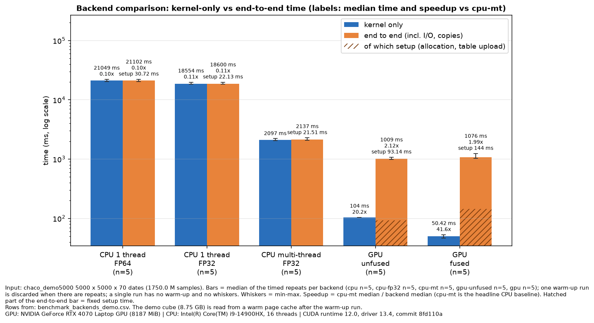
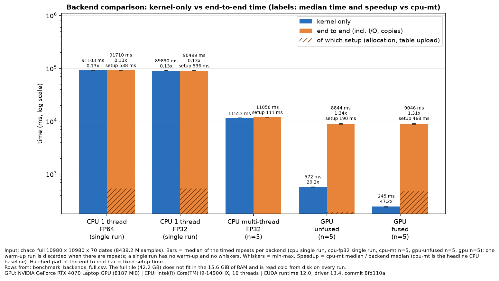
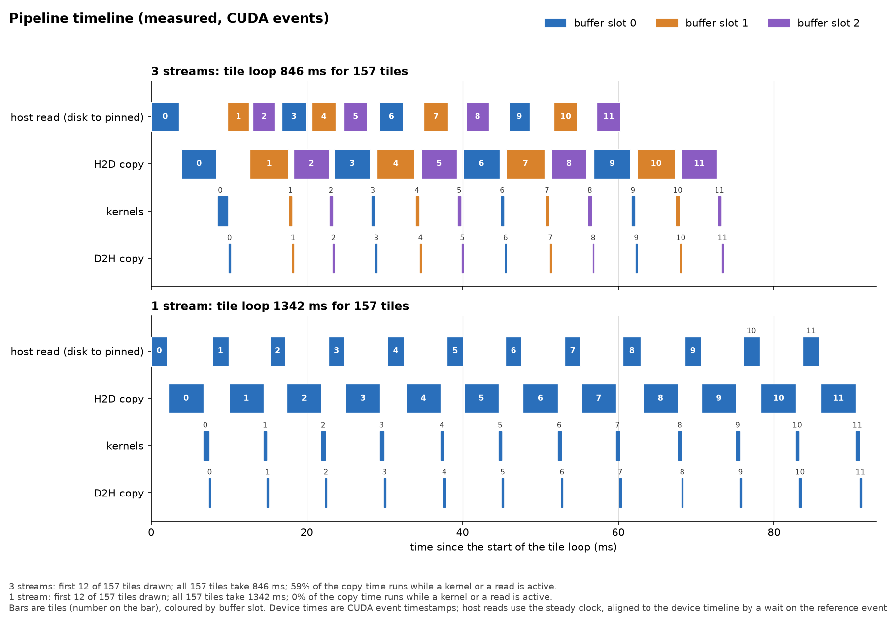
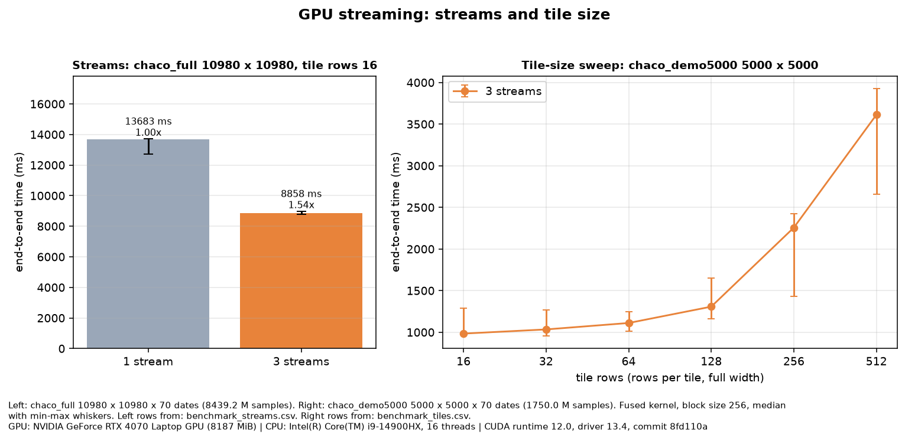
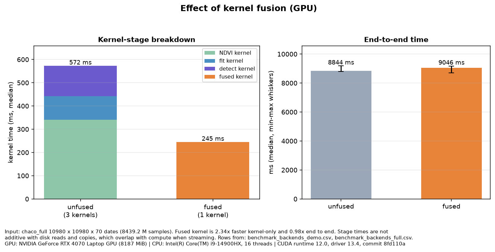
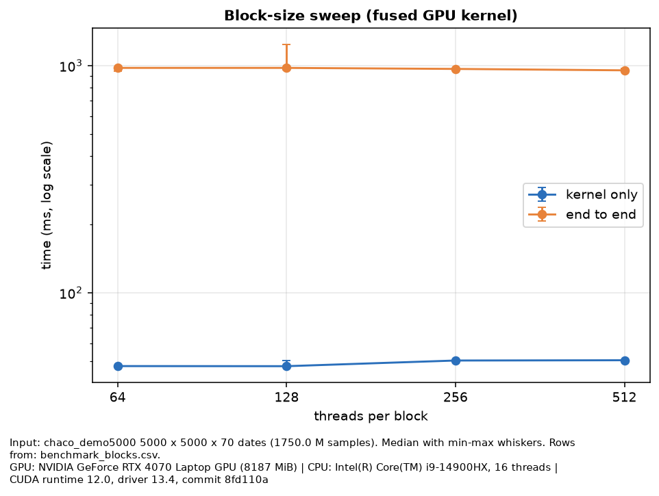
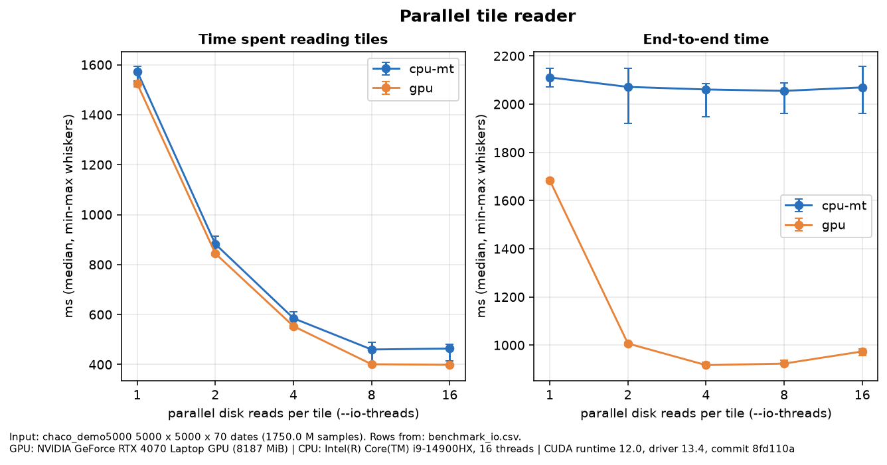
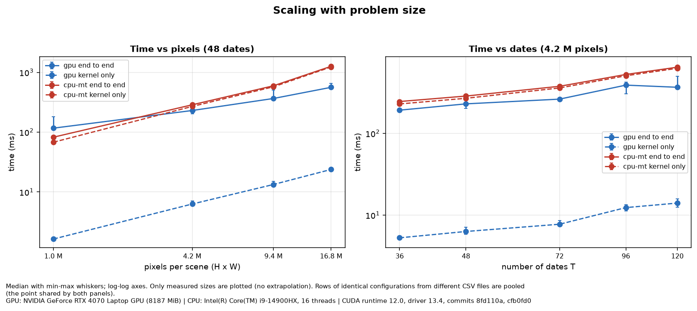

# Benchmarks

How the CPU and GPU backends were compared, every sweep that was run, and what
the numbers do and do not show. All numbers come from the CSV files in
`results/csv/` and the logs in `results/logs/`; the figures in
`results/figures/` are drawn from the same CSVs by `scripts/plot_benchmarks.py`.

**Summary.** On the full 10,980 x 10,980 x 70 tile (120.6 M time series, 42.2 GB)
the fused GPU kernel is 47x faster than 16 CPU threads (245 ms vs 11,553 ms) and
the GPU run is 1.31x faster end to end (9.05 s vs 11.86 s; this is backend time,
excluding output writing; the two single headline detect runs give 1.22x
wall-clock including output writing, section 2). On the 5,000 x 5,000
x 70 demo cube the kernel is 42x faster and the end-to-end gain is 1.99x. The
end-to-end gain is small because the run is bound by reading the input and
copying it over PCIe, not by computation.

## 1. Method

### Machine

| Item | Value | Source |
| --- | --- | --- |
| GPU | NVIDIA GeForce RTX 4070 Laptop GPU, 8,188 MiB, compute capability 8.9, 36 SMs | `results/logs/hardware.txt`, log headers |
| GPU power state | idle (P5 / P8) when the snapshots were taken; board power limit 80 W (default 55 W, maximum 140 W) | `results/logs/hardware.txt` |
| Driver / CUDA | driver 616.56 (CUDA UMD 13.4), CUDA runtime 12.0, nvcc 12.0.140 | log headers, `INSTALL` |
| CPU | Intel Core i9-14900HX; **WSL2 exposes 16 of the 32 hardware threads**. `lscpu` inside WSL2 reports a virtual topology of 8 cores x 2 threads; the physical CPU has 8 performance and 16 efficiency cores (Intel specification), and which 16 threads WSL2 exposes is unknown | `hardware.txt` (`lscpu`, `nproc`) |
| RAM | 15.6 GiB visible to WSL2 (`free -h`: 15 GiB total), 4 GiB swap | `hardware.txt` |
| Storage | 1 TB WSL2 virtual disk (`/dev/sdc`, ext4), backed by the laptop's NVMe SSD (the host drive model was not recorded) | `hardware.txt` (`df`) |
| OS | Ubuntu 24.04.5 under WSL2, kernel 5.15.167.4 | `hardware.txt` |
| Power and load | AC power online; load average 0.76 / 1.36 / 1.43 before the first run (the machine was not otherwise idle: the owner's background services were running); GPU idle (P8, 3 %, 4.61 W) | `results/logs/measurement_run_console.txt` (first lines) |
| Code | commit `8fd110a` (clean tree, per the first line of `measurement_run_console.txt`) for every C++ run, `cfb0fd0` for the date-scaling sweep and the textbook-defaults demo run (same binary; only a script changed) | `git_commit` column of the CSVs |

The CPU baselines are built with `-O3 -march=native -ffp-contract=off` (no
fused multiply-add contraction, so FP32 results are reproducible across thread
counts). The multithreaded baseline (`cpu-mt`) runs 16 compute threads, plus
8 reader threads (`--io-threads 8`, the same reader as the GPU backends) and one
thread that prefetches the next tile, all on the 16 visible hardware threads;
the other 16 hardware threads of the CPU are not reachable from this WSL2
instance. The per-pixel fit and detection loop is scalar code per pixel; only the
NDVI computation of a block of 16 neighbouring pixels is written so that the
compiler can vectorise it (`src/cpu/cpu_backend.cc`). SIMD across pixels for the
fit was not tried, so a hand-vectorised CPU baseline might be faster than the one
measured. Evidence that the baseline scales: `cpu-mt` is 10.0x faster than one
thread on the demo cube (kernel 21,049 / 2,097 ms) and 7.9x on the full tile
(91,103 / 11,553 ms).

### Backends

| Backend | Description |
| --- | --- |
| `cpu` | one thread, FP64: reference implementation and correctness oracle |
| `cpu-fp32` | one thread, FP32: separates precision effects from hardware effects |
| `cpu-mt` | 16 threads, FP32: **the headline comparison** |
| `gpu-unfused` | separate NDVI, fit and detect kernels (stores the NDVI cube) |
| `gpu` | one fused kernel per pixel (default) |

All backends run the same algorithm and the same per-pixel source
(`src/pixel_model.h`), read the same prepared raw arrays with the same reader
(`--io-threads 8`) and the same tile-size rule (at most 64 MiB of input per
tile), and use identical parameters: the program defaults (threshold 3.5,
consecutive 2, K = 2, trend hold, `--losses-only` off).

### Procedure

* `--mode benchmark --warmup 1 --repeat 5`: one warm-up run is discarded, then 5
  timed repetitions are written to the CSV; the tables show the **median** and
  the **minimum-maximum** range of the 5 repeats. Exceptions are marked "single
  run": the full-tile `cpu` and `cpu-fp32` runs take 90 s each and were run once
  (no warm-up, no spread).
* "**Kernel only**" is `kernel_ms`: the sum of the CUDA-event times of the GPU
  kernels, or the time of the compute loop on the CPU (excluding waiting for
  reads).
* "**End to end**" is `total_ms` (`backend_total` in the log): wall time from
  the start of setup (allocations, table upload) through reading, copying and
  computing until all results are in host memory and the buffers are released.
  It excludes post-processing and writing the output files, which are the
  same for all backends. Sections 3.2 and 4 of `docs/FORMATS.md` define every field and column.
* Inputs are pre-converted raw arrays; no image decoding is timed.
* **Cache state.** The demo cube (8.75 GB) and the dev cube fit in RAM and are
  read from a **warm page cache** after the warm-up run, so their `read_ms`
  measures memory copies. The full tile (42.2 GB) does not fit in 15.6 GiB of
  RAM, so it is read **uncached in practice** in every repetition
  (`results/logs/hardware.txt` records this for every sweep); the page cache
  could not be dropped (no root), so "cold" is inferred from the size, not
  forced. The two regimes must not be compared with each other. For the demo cube
  a cold run was not measured.
* Synthetic cubes of the scaling sweeps are generated in memory (no disk reads).
* **Provenance.** All detection measurements were made with the build at commit
  `8fd110a` (every log records it in `git_commit:`; the first line of
  `results/logs/measurement_run_console.txt` records a clean tree). The
  date-scaling sweep and the textbook-defaults comparison on the demo cube ran at
  `cfb0fd0`, which changed only a script (the binary is the same). The
  co-registration run (not a benchmark) is at `1003e00` (code unchanged since
  `6cf6c38`). Later commits add only the co-registration mode and documentation.
  The unit-test logs are produced from the final committed tree (see their
  `git_commit:` line), not from the measured build.
* The sweeps ran one after another with the GPU otherwise idle (the script
  refuses to start while another `change_detect` is running).
* `results/csv/benchmark_summary.csv` pools identical default configurations
  from several sweeps (for example 30 GPU repetitions on the demo cube, 10 on the
  full tile) and is not used for the numbers below. Pooled, the fused GPU median
  is 1,026 ms on the demo cube and 8,905 ms on the full tile, against 1,076 ms
  and 9,046 ms in the dedicated backend sweeps.

## 2. Backends: kernel only and end to end

Sources: `results/csv/benchmark_backends_demo.csv`,
`results/csv/benchmark_backends_full.csv`; logs
`results/logs/bench/log_backends_demo_all_5000x5000x70.txt`,
`results/logs/bench/log_backends_full_*.txt`. Times in ms, median [min-max].

### Demo cube, 5,000 x 5,000 x 70 (25 M series, 1.75 G samples), warm page cache

| Backend | n | Kernel only | End to end | End-to-end throughput (M samples/s) | Kernel speedup vs `cpu-mt` | End-to-end speedup vs `cpu-mt` | End-to-end speedup vs `cpu` |
| --- | --- | --- | --- | --- | --- | --- | --- |
| `cpu` (1 thread, FP64) | 5 | 21,049 [20,160-22,110] | 21,102 [20,209-22,195] | 83 | 0.10x | 0.10x | 1x |
| `cpu-fp32` (1 thread) | 5 | 18,554 [18,378-19,775] | 18,600 [18,424-19,826] | 94 | 0.11x | 0.11x | 1.13x |
| **`cpu-mt` (16 threads)** | 5 | 2,097 [2,034-2,247] | 2,137 [2,073-2,289] | 819 | 1x | 1x | 9.9x |
| `gpu-unfused` | 5 | 103.9 [103.7-104.3] | 1,009 [992-1,078] | 1,734 | 20.2x | 2.12x | 20.9x |
| **`gpu` (fused)** | 5 | **50.4** [46.7-53.2] | **1,076** [1,033-1,245] | 1,627 | **41.6x** | **1.99x** | **19.6x** |

Kernel-only throughput of the fused kernel: 34,711 M samples/s (`cpu-mt`: 834,
`cpu`: 83). The fused GPU run is 17.3x faster end to end than the single-thread
FP32 CPU. `cpu-mt` is 9.9x faster end to end (10.0x on the kernels) than one thread on 16 threads.



### Full tile, 10,980 x 10,980 x 70 (120.6 M series, 8.44 G samples, 42.2 GB), uncached in practice

| Backend | n | Kernel only | End to end | End-to-end throughput (M samples/s) | Kernel speedup vs `cpu-mt` | End-to-end speedup vs `cpu-mt` | End-to-end speedup vs `cpu` |
| --- | --- | --- | --- | --- | --- | --- | --- |
| `cpu` (1 thread, FP64) | 1, single run | 91,103 | 91,710 | 92 | 0.13x | 0.13x | 1x |
| `cpu-fp32` (1 thread) | 1, single run | 89,890 | 90,499 | 93 | 0.13x | 0.13x | 1.01x |
| **`cpu-mt` (16 threads)** | 5 | 11,553 [11,497-11,560] | 11,858 [11,843-11,892] | 712 | 1x | 1x | 7.7x |
| `gpu-unfused` | 5 | 572.5 [568.6-574.5] | 8,844 [8,791-9,182] | 954 | 20.2x | 1.34x | 10.4x |
| **`gpu` (fused)** | 5 | **244.5** [237.1-247.8] | **9,046** [8,710-9,175] | 933 | **47.2x** | **1.31x** | **10.1x** |

Kernel-only throughput of the fused kernel: 34,512 M samples/s. The speedups
against `cpu` and `cpu-fp32` compare against single runs. Precision is not the
reason the single-thread CPU is slow: FP32 is only 1.13x faster than FP64 on the
demo cube and 1.01x on the full tile.



### The headline detect run against single-run CPU baselines

`results/logs/log_detect_gpu_10980x10980x70_full.txt` is one execution of
`--mode detect` (with outputs) over the full tile; the CPU logs are single runs
of the same command with `--backend cpu-mt` and `--backend cpu`. They are
separate measurements from the benchmark medians above and the two should not be
mixed in one sentence.

| Backend | Kernel total (ms) | Backend total (ms) | Wall total (ms) | Wall speedup vs `cpu-mt` | Wall speedup vs `cpu` |
| --- | --- | --- | --- | --- | --- |
| `gpu` | 264 | 9,660 | 11,589 | 1.22x | 8.5x |
| `cpu-mt` | 11,313 | 12,305 | 14,111 | 1x | 6.96x |
| `cpu` | 95,437 | 96,133 | 98,260 | 0.14x | 1x |

Kernel total ratio `cpu-mt` / `gpu`: 42.8x. The demo detect log
(`log_detect_gpu_5000x5000x70_demo.txt`, 3.319 s wall) is a first read that was
partly cold (read 3.6 GB/s) and is not comparable with the warm 1.076 s benchmark
median of the same cube. `wall_total` additionally includes
post-processing (177 ms for the GPU), reading the reference and writing the
outputs (1,557 ms for the GPU).

## 3. Where the time goes

Medians from the backend sweeps (ms):

| Stage | Demo, GPU fused (warm cache) | Full tile, GPU fused (uncached in practice) | Full tile, `cpu-mt` |
| --- | --- | --- | --- |
| read input (disk or page cache to pinned buffer) | 416 | 8,226 | 10,147 |
| host-to-device copies (sum of copy events) | 746 | 4,596 | - |
| kernels | 50.4 | 244.5 | 11,553 |
| device-to-host copies | 28 | 171 | - |
| setup (allocation, table upload) | 144 | 468 | 111 |
| **end to end** | **1,076** | **9,046** | **11,858** |

The stages overlap, so they do not add up to the end-to-end time. Reading:

* **GPU, full tile.** The read of 42.2 GB takes 8.2 s (91 % of the end-to-end
  time, 5.1 GB/s with 8 reader threads) and the copy-in takes 4.6 s
  (about 9.2 GB/s); the two overlap. The kernels are 2.7 % of the end-to-end time.
  Using three streams already hides the copy-out and the kernels under the next
  tile's copy-in; the remaining time is the read and the copy-in, which more
  streams cannot shorten.
* **GPU, demo cube.** The read is a page-cache copy (0.42 s). The copy-in of
  8.75 GB takes 0.75 s (about 11.7 GB/s): the GPU run is PCIe-bound at 5 bytes
  per sample. Kernels are 4.7 % of the end-to-end time.
* **`cpu-mt`, full tile.** The compute (11.55 s) is longer than the read
  (10.1 s), so the CPU run is compute-bound and the read is hidden behind it.
* **Measured timeline** (`results/figures/pipeline_timeline_measured.png`, demo
  cube, tiles of 32 rows, 157 tiles): the tile loop takes 847 ms with 3 streams
  and 1,342 ms with 1 stream, and 59 % of the copy time overlaps a kernel or a
  host read with 3 streams (0 % with 1). Reproduce the numbers with
  `.venv/bin/python scripts/plot_timeline.py --trace results/csv/pipeline_trace_streams3_demo.csv --trace results/csv/pipeline_trace_streams1_demo.csv --labels "3 streams" "1 stream" --out <png>`,
  which prints `loop 846.5 ms ... copy hidden 59%` and `loop 1341.6 ms ... copy
  hidden 0%`. The loop time is the end of the last stage of the last tile; the
  hidden share is the part of the host-to-device and device-to-host copy time
  during which a kernel or a host read is also active.



## 4. Streams

`results/csv/benchmark_streams.csv`, GPU fused, 5 repeats, end to end in ms:

| Cube | 1 stream | 3 streams | Gain |
| --- | --- | --- | --- |
| demo (32-row tiles, warm) | 1,540 [1,534-1,593] | 1,258 [1,218-1,267] | 1.22x |
| full tile (16-row tiles, uncached) | 13,683 [12,728-13,715] | 8,858 [8,792-8,978] | 1.54x |

(The 3-stream demo median of 1,258 ms here is higher than the 1,076 ms of the
backend sweep: different runs, different moment; the sweeps are not pooled.)
Kernel time is also lower with three streams (demo 74 ms to 53 ms, full 414 ms
to 233 ms); the reason was not investigated. Results are identical for 1 and 3
streams.



(The figure shows the streams comparison for the full tile on the left and the
tile-size sweep of the demo cube, section 5, on the right; the demo-cube
streams numbers are in the table only.)

## 5. Tile size

`results/csv/benchmark_tiles.csv`, GPU fused, demo cube, 3 streams, 5 repeats
(the 32-row row has 10 repeats because the automatic tile size is also 32 rows):

| Tile rows | Tiles | End to end (ms) | Setup (ms) | Kernel (ms) |
| --- | --- | --- | --- | --- |
| 16 | 313 | 984 [974-1,288] | 54 | 56.4 |
| 32 (automatic) | 157 | 1,034 [953-1,271] | 81 | 50.4 |
| 64 | 79 | 1,111 [1,015-1,248] | 174 | 43.8 |
| 128 | 40 | 1,307 [1,161-1,651] | 291 | 43.2 |
| 256 | 20 | 2,257 [1,434-2,427] | 1,097 | 43.5 |
| 512 | 10 | 3,613 [2,659-3,930] | 2,139 | 48.2 |

Smaller tiles are faster here, because the setup (pinned host and device
allocations of three slots) grows roughly in proportion to the tile size while the
kernel time does not depend on it. This is also why the automatic size is capped
at 64 MiB of input per tile. The effect is the cost of pinned allocation on
WSL2, not a property of the GPU kernels.

## 6. Fusion and block size

Fusion (kernel time, from the backend sweeps): fused 50.4 ms vs unfused
103.9 ms on the demo cube (2.1x) and 244.5 ms vs 572.5 ms on the full tile
(2.3x). End to end the two are within the run-to-run range (demo: 1,076 ms vs
1,009 ms; full: 9,046 ms vs 8,844 ms), because the run is read and copy bound.
The figure `results/figures/benchmark_fusion.png` shows the full-tile case: the
unfused 572 ms split into its NDVI, fit and detect kernels beside the single
245 ms fused kernel, and the end-to-end bars (fused 0.98x of unfused, within the
spread). The unfused backend needs more device memory for its NDVI cube (305 MiB vs
166 MiB of pipeline buffers on the demo cube).



Block size, `results/csv/benchmark_blocks.csv`, demo cube, end to end (ms) and
kernel time (ms):

| Block size | `gpu` end to end | `gpu` kernel | `gpu-unfused` end to end | `gpu-unfused` kernel |
| --- | --- | --- | --- | --- |
| 64 | 978 | 47.6 | 994 | 99.5 |
| 128 | 978 | 47.5 | 996 | 103.2 |
| 256 | 968 | 50.3 | 995 | 104.0 |
| 512 | 954 | 50.5 | 977 | 103.5 |

The block size has no visible effect in the range 64-512 (kernel differences of
a few percent, end-to-end differences within the noise); the default 256 was kept.



(The figure draws the fused backend only; the unfused numbers are in the table.)

## 7. Reader threads

`results/csv/benchmark_io.csv`, demo cube (warm cache), end to end (ms):

| `--io-threads` | `gpu` | `gpu` read | `cpu-mt` | `cpu-mt` read |
| --- | --- | --- | --- | --- |
| 1 | 1,684 | 1,525 | 2,111 | 1,574 |
| 2 | 1,007 | 844 | 2,072 | 882 |
| 4 | 917 | 553 | 2,061 | 585 |
| 8 (default) | 923 | 401 | 2,055 | 460 |
| 16 | 974 | 399 | 2,070 | 464 |

The GPU run is 1.84x faster with 4 reader threads than with 1; beyond 4 it does
not improve (the copy-in is then the limit). `cpu-mt` does not change: its
compute time hides the read. These are warm-cache numbers, so the effect of
parallel reads on an uncached disk is not measured here (on the full tile the
headline run reads at 5.1 GB/s with 8 threads, but there is no 1-thread
comparison with a dropped cache).



## 8. Scaling

Synthetic cubes generated in memory (so no disk is involved), GPU fused vs
`cpu-mt`, 5 repeats, median end to end in ms.

**With the number of pixels** (48 dates, 4 years;
`results/csv/benchmark_scaling_pixels.csv`):

| Pixels | `gpu` end to end | `cpu-mt` end to end | End-to-end speedup | `gpu` kernel | `cpu-mt` kernel | Kernel speedup |
| --- | --- | --- | --- | --- | --- | --- |
| 1.05 M (1,024^2) | 116.8 | 82.4 | **0.71x** | 1.6 | 68.0 | 41.7x |
| 4.19 M (2,048^2) | 209.9 | 289.7 | 1.38x | 5.9 | 269.8 | 46.1x |
| 9.44 M (3,072^2) | 366.6 | 598.5 | 1.63x | 13.3 | 575.5 | 43.2x |
| 16.8 M (4,096^2) | 563.5 | 1,265.9 | 2.25x | 23.8 | 1,235.6 | 51.9x |

At 1 M pixels the fixed GPU setup (about 57 ms) and the copy dominate and the
16-thread CPU is faster end to end. At 4.19 M pixels the ranges of the two
overlap (GPU 202-292 ms, `cpu-mt` 285-300 ms), so the 1.38x there is within the
noise; from about 9 M pixels the ranges no longer overlap. The same
configuration (2,048^2 x 48) gives 209.9 ms in this sweep and 248.9 ms in the
dates sweep, and the point drawn in `figures/benchmark_scaling.png` for it pools
the rows of both CSVs (as its caption says), so it matches neither table.

**With the number of dates** (2,048 x 2,048 = 4.19 M pixels, monthly dates, a
fixed 24-date training window; `results/csv/benchmark_scaling_dates.csv`):

| Dates T | `gpu` end to end | `cpu-mt` end to end | End-to-end speedup | `gpu` kernel | `cpu-mt` kernel | Kernel speedup |
| --- | --- | --- | --- | --- | --- | --- |
| 36 | 193.0 | 246.4 | 1.28x | 5.3 | 230.1 | 43.8x |
| 48 | 248.9 | 287.2 | 1.15x (ranges overlap) | 6.7 | 270.2 | 40.0x |
| 72 | 263.6 | 378.7 | 1.44x | 7.7 | 361.3 | 46.9x |
| 96 | 391.4 | 529.1 | 1.35x | 12.3 | 510.0 | 41.4x |
| 120 | 368.4 | 649.4 | 1.76x | 14.0 | 629.7 | 45.0x |

The GPU end-to-end values for 96 and 120 dates have wide ranges
([307-428] and [352-503] ms) and are not monotonic; they are reported as
measured. The 48-date row of this sweep (248.9 ms) and the 2,048^2 row of the pixel
sweep (209.9 ms) are the same configuration measured at different times.
The first version of this sweep used a fixed 4-year span, so with 12 or 24
dates too few training observations remained and most pixels skipped monitoring;
that design was corrected before the numbers above were taken
(`results/logs/bench_console.txt` still shows the first version in its
`scaling_dates` section; `results/logs/hardware_scaling_dates_rerun.txt` is the
snapshot of the re-run).



## 9. Accuracy of the benchmarked backends

Agreement with the FP64 `cpu` run (from the same CSVs and logs):

* Demo cube: `agree_break_frac` and `agree_status_frac` are 1.000000 for all
  backends in `benchmark_backends_demo.csv`; the number of changed pixels is
  4,589,072 for both GPU backends and 4,589,077 for the three CPU backends (a
  difference of 5 pixels of 25 M).
* Full tile: 23,090,187 changed pixels (GPU), 23,090,189 (`cpu-mt`, `cpu-fp32`)
  and 23,090,200 (`cpu`) of 120.6 M. The headline run's log prints the agreement of GPU
  against `cpu` as 1.0000 (four decimals), and the dev log gives a largest
  coefficient difference of 5.4e-07
  (`results/logs/log_detect_gpu_2048x2048x70_dev.txt`).

Exact pixel counts for the full tile come from `scripts/compare_outputs.py`,
which compares the break index and status maps of the detect runs of the three
backends pixel by pixel (`results/csv/agreement_full.csv`, 120,560,400 pixels per
pair):

| Pair | Break index differs | Status differs | Fraction of pixels that differ |
| --- | --- | --- | --- |
| GPU vs `cpu` (FP64) | 6 | 5 | 5.0e-08 |
| GPU vs `cpu-mt` (FP32) | 9 | 5 | 7.5e-08 |
| `cpu-mt` (FP32) vs `cpu` (FP64) | 9 | 4 | 7.5e-08 |

The FP32 CPU build differs from FP64 on as many pixels (9) as the GPU does (6).
The differences are therefore FP32 versus FP64 rounding at pixels whose
statistic lies exactly on the threshold, not an effect of the GPU; the cause
was inferred from this pattern and not checked for each pixel. Where the break
index is the same the break magnitudes agree to 7.7e-07 or better.

## 10. Honest limits

* **A laptop GPU.** The RTX 4070 Laptop GPU has a limited power budget (80 W
  board power limit at the snapshot) and 8 GB of memory; a desktop or data-centre
  GPU would give other numbers, as would a faster disk or PCIe link.
* **Hardware dependence.** The CPU used 16 of its 32 hardware threads (WSL2). On
  a CPU with more visible threads the `cpu-mt` baseline would be faster and the
  GPU's gain smaller.
* **End-to-end gains are modest.** The full-tile run is limited by reading
  42.2 GB and copying it to the GPU, not by computation. The kernel-only
  speedups (42x-47x) describe the compute part; the end-to-end speedups
  (1.31x full, 1.99x demo) describe what a user waits for on this machine.
* **Warm versus uncached.** The demo and dev cubes are read from the page cache
  after the warm-up; the full tile does not fit in RAM and is uncached in
  practice (the cache could not be dropped). They are different regimes.
* **Single runs.** The full-tile `cpu` and `cpu-fp32` numbers are single runs
  without warm-up or spread.
* **Measured sizes only.** Nothing is extrapolated beyond the measured cubes
  (up to 10,980 x 10,980 x 70 for the real data, 4,096 x 4,096 x 48 and 2,048 x
  2,048 x 120 for the synthetic scaling sweeps).
* **Noise.** The machine was not otherwise idle, and the GPU runs show spreads
  of up to 20 % between minimum and maximum in some sweeps (for example demo
  `gpu` end to end 1,033-1,245 ms); medians of 5 are given with the range.
* **No profiler.** Nsight Systems could not import its traces on this machine,
  so the timeline is drawn from the pipeline's own event timestamps, and no
  Nsight Compute numbers are reported.
* **Benchmark parameters.** The benchmarks use the program defaults without
  `--losses-only`; the detect runs used for validation use `--losses-only`.
  Compute cost is the same to within the spread: kernel totals of the detect
  runs (with `--losses-only`, and for the GPU including the validation kernel) are
  GPU 264.3 ms vs 244.5 ms, `cpu-mt`
  11,313 ms vs 11,553 ms and `cpu` 95,437 ms vs 91,103 ms in the benchmark
  (`log_detect_*_full.txt` vs `benchmark_backends_full.csv`); the outputs differ.

## 11. Reproduce

```bash
bash scripts/run_benchmarks.sh --dry-run      # list every command and the expected rows
bash scripts/run_benchmarks.sh                # all sweeps (about 20 minutes, needs the demo and full cubes)
bash scripts/run_benchmarks.sh --only backends_demo
```

The sweeps are `backends_demo backends_full streams tiles blocks io
scaling_dates scaling_pixels`; each CSV is checked by `scripts/check_csv.py` and
the figures are drawn by `scripts/plot_benchmarks.py`. The exact command of each
run is in the first lines of its log under `results/logs/bench/`.
