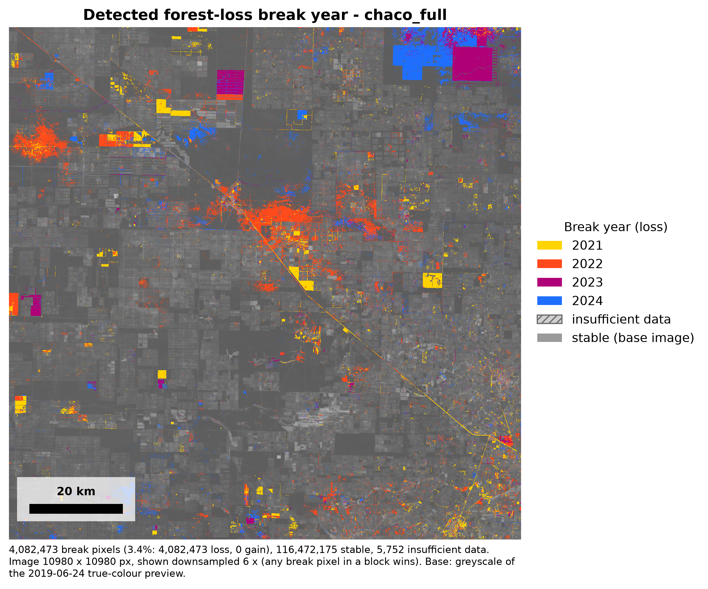
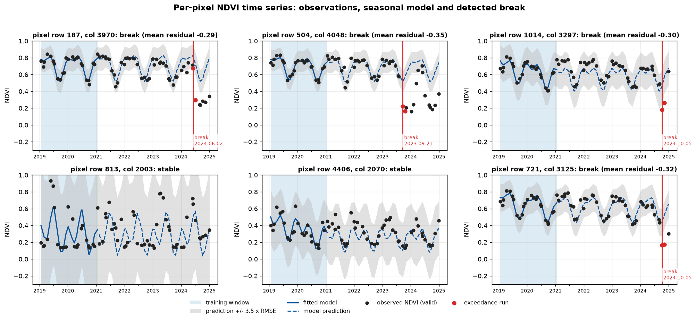
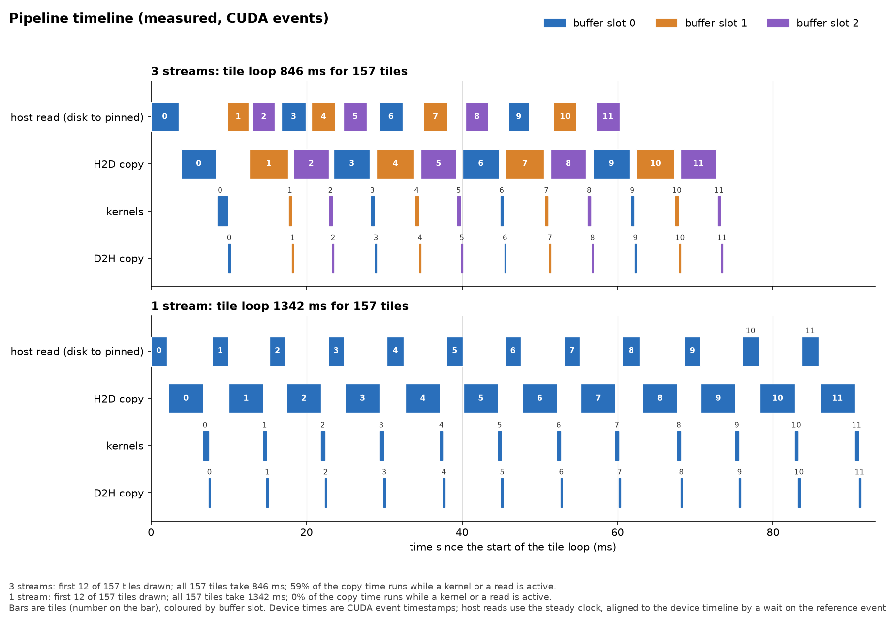
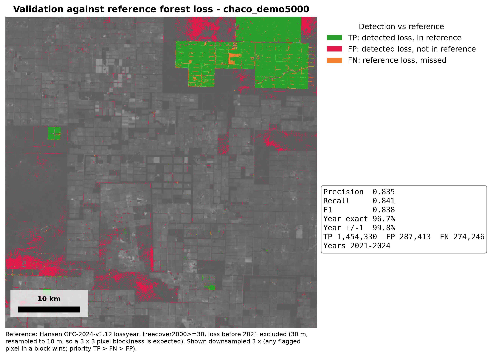
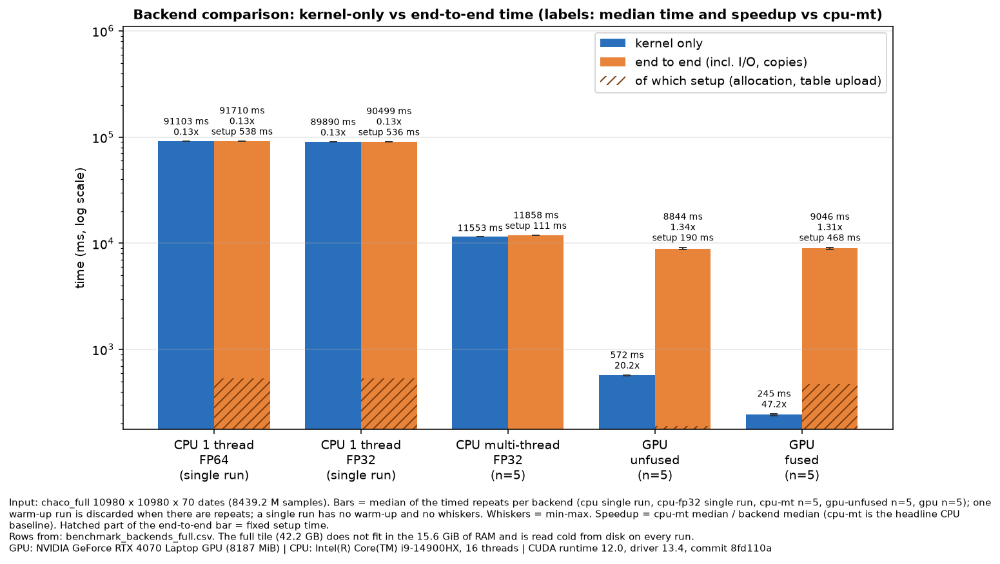

# GPU time-series change detection on Sentinel-2 imagery

## 1. Summary

`change_detect` is a CUDA C++ program that finds, for every pixel of a satellite image time series, the date when the land stopped behaving like its own seasonal pattern. It ran on a full Sentinel-2 tile of the Paraguayan Chaco (10,980 x 10,980 pixels, 70 monthly scenes, 2019-2024): **120,560,400 per-pixel time series (8.44 billion samples, 42.2 GB) in 11.6 s** on a laptop RTX 4070, validated against the Hansen forest-loss data with F1 0.816 against pixels the reference can judge (`results/logs/log_detect_gpu_10980x10980x70_full.txt`). A CPU can do the same computation; measured on this machine the fused GPU kernels are 47x faster than 16 CPU threads, but the whole run is only 1.31x faster end to end (1.22x wall-clock for the two single headline runs, which include writing outputs) because it is limited by disk reads and PCIe copies (medians of 5, `results/csv/benchmark_backends_full.csv`).



## 2. Purpose and context

Mapping where and when land changed, for example forest cleared for pasture or crops, is the basis of environmental monitoring. Per-pixel time-series methods such as BFAST, CCDC and LandTrendr fit a model to each pixel's history and test later observations against it. The work is independent per pixel, which suits a GPU: every pixel needs a regression fit and a residual test over every later date, for hundreds of millions of independent pixels. This project implements a small member of that family (harmonic regression plus a run-of-exceedances rule) from scratch in CUDA, with CPU versions of the same algorithm as baselines and oracle.

## 3. Data

* **Imagery:** Sentinel-2 L2A red (B04), near-infrared (B08) and the scene classification (SCL) for MGRS tile 20KQA, from the Earth Search catalogue. One best scene per month, 70 dates from 2019-01-20 to 2024-12-29 (2022-07 and 2023-12 had no scene below 20 % cloud). Clouds, shadows and no-data are masked with the SCL (valid classes 4, 5, 6).
* **Size:** 10,980 x 10,980 pixels x 70 dates x 5 bytes (two uint16 bands and a uint8 mask) = 42.2 GB, more than twice the 15.6 GiB of RAM and about five times the 8 GB of GPU memory. A 5,000 x 5,000 demo window (8.75 GB), a 2,048 x 2,048 development window (1.47 GB) and a committed 128 x 128 sample are cut from the same tile.
* **Reference:** Hansen Global Forest Change GFC-2024-v1.12 `lossyear`, resampled from 30 m to the 10 m grid. It is a sanity check, not ground truth: annual, forest-only, 30 m.
* Windows were chosen by evidence (Hansen loss in 2021-2024), so the reference marks 19.7 % (dev) and 17.6 % (demo) of its eligible pixels as loss against 7.2 % for the whole tile (`results/csv/validation_coverage.csv`). The tuning window (dev) does not overlap the validation window (demo), but the full tile contains both, so its scores are not an independent test. Commands: `data/README.md`.

## 4. Algorithm

With NDVI `y` and `tau` the time in years, each pixel is modelled as a trend plus K yearly harmonics:

`y = a0 + a1 s(tau) + sum_k [ b_k cos(2 pi k tau) + c_k sin(2 pi k tau) ] + e`

with `s` centred and scaled to [-1, 1] over the training window. The model is fitted by least squares on the first two years (25 dates) by accumulating `X^T X` and `X^T y` and solving with a Cholesky decomposition inside the thread. For each later valid observation `z = (y - prediction) / RMSE`; a break starts the first run of `--consecutive` same-sign exceedances of `|z| > threshold`. Its date, mean residual and direction are recorded; `--losses-only` keeps greenness losses. Pixels with fewer than 18 valid training observations are reported as "insufficient data".

**Parameters.** K = 2, threshold 3.5, M = 2, rmse floor 0.02, trend held after the training window. They were chosen by a 28-configuration sweep on the development cube (`results/csv/tuning_dev.csv`): the threshold is the dominant knob (F1 spread 0.22), then M (0.11); the RMSE floor, extra mask classes and cleanup barely matter. Threshold 3 / M 2 and 3.5 / M 2 tie at F1 0.906, and the more conservative 3.5 was taken. The setting was fixed on the dev cube and then scored on the demo cube without changes; the demo cube was afterwards also scored with other settings for context only, and none was adopted.



## 5. GPU implementation

* **Layout.** The cube is date-major: at one date neighbouring threads read neighbouring pixels (coalesced), while each thread loops over the dates of its own pixel. Fit coefficients are stored coefficient-major so writes coalesce too.
* **Kernels.** One thread per pixel for `FitHarmonicModelKernel`, `DetectBreakKernel` and the fused `FusedChangeDetectionKernel`; `ComputeNdviKernel` has one thread per (date, pixel); `CleanupKernel` is a 3x3 stencil with a shared-memory halo; `ConfusionKernel` reduces validation counts with warp shuffles and one `atomicAdd` per block. The per-pixel mathematics is a single header, `pixel_model.h`, compiled for the GPU in FP32 and for the CPU in FP64 and FP32.
* **Fused versus unfused.** The fused kernel recomputes NDVI from the raw bands in three passes instead of storing a float NDVI cube. It takes 245 ms against 572 ms for the unfused kernels on the full tile, with the same results and half the device memory (166 vs 305 MiB on the demo cube).
* **Tiles and streaming.** A tile is a band of full-width rows, sized so three slots use at most half of the free device memory and capped at 64 MiB of input (687 tiles of 16 rows for the full tile). Three pinned host slots, three device slots and three streams with events overlap the disk read of tile k+2, the upload of tile k+1 and the kernel of tile k. A pool of 8 reader threads issues the many `pread` calls of a tile in parallel.
* **Constant memory.** The per-date design rows and the per-date scale and offset (40 KiB) live in constant memory, which broadcasts them because all threads of a warp read the same date.
* **cuFFT.** The co-registration mode batches the dates into `cufftPlanMany` real-to-complex transforms, forms the normalised cross-power spectrum in a kernel and finds the correlation peak with a block reduction and a sub-pixel parabola fit.
* **Tuning.** `--block-size` is a run-time flag; 64 to 512 made no visible difference, so the default is 256.



*Measured with CUDA events on the demo cube: the tile loop takes 847 ms with 3 streams and 1,342 ms with 1; 59 % of the copy time overlaps a kernel or a read (printed by `scripts/plot_timeline.py` from `results/csv/pipeline_trace_streams{3,1}_demo.csv`).*

## 6. Verification

* **Unit tests:** `make test` passes the GPU tests and `make test-cpu` 157 CPU tests, including synthetic cubes with injected breaks. On a synthetic 512 x 512 x 48 cube with 20 % clouds, 98.8 % of the eligible injected breaks are recovered and 1.2 % of stable pixels give a false break (`results/logs/log_smoke_synthetic_512x512x48.txt`).
* **GPU versus CPU:** the GPU and the FP64 CPU reference give identical break index and status on the dev cube (largest coefficient difference 5.4e-07). On the full tile, pixel by pixel, the break index differs on 6 of 120,560,400 pixels for GPU against FP64 and on 9 for the FP32 CPU against FP64 (`results/csv/agreement_full.csv`): FP32 rounding at pixels whose statistic sits exactly on the threshold, as much a property of FP32 as of the GPU.
* **Co-registration:** `--mode coreg` checks that the 70 dates lie on one pixel grid, using cuFFT phase correlation. On the demo cube (2,048 x 2,048 window) the median shift against the reference date is 0.10 px, the maximum 0.51 px and no date is flagged (`results/csv/coreg_shifts_demo.csv`).
* **Validation against Hansen.** Precision, recall and F1: dev 0.968 / 0.852 / 0.906; demo (not used to choose the parameters) 0.835 / 0.841 / 0.838; full tile (includes both windows) 0.809 / 0.823 / 0.816. The year of the break matches Hansen's exactly for 92.5 % of true positives on the full tile and within one year for 98.9 %. These scores cover only pixels the reference can judge: 877,787 of the 4,082,473 detected pixels on the full tile (21.5 %) are not scored, and counting them as false positives would lower the precision to 0.635 (demo 0.736, dev 0.933; `results/csv/validation_coverage.csv`).



## 7. Benchmarks

Method: warm-up run discarded, 5 repeats, median and min-max; the CPU baselines are built with `-O3 -march=native` and read the same raw arrays; hardware and software are in `docs/BENCHMARKS.md`. "End to end" runs from the start of setup until the results are in host memory.

| Cube | Backend | Kernel only (ms) | End to end (ms) | Speedup vs 16-thread CPU (kernel / end to end) |
| --- | --- | --- | --- | --- |
| demo 25 M series (warm cache) | CPU 1 thread FP64 | 21,049 | 21,102 | 0.10x / 0.10x |
| | CPU 16 threads | 2,097 | 2,137 | 1x |
| | GPU fused | 50.4 | 1,076 | 41.6x / 1.99x |
| full tile 120.6 M series (uncached in practice) | CPU 1 thread FP64 (single run) | 91,103 | 91,710 | 0.13x / 0.13x |
| | CPU 16 threads | 11,553 | 11,858 | 1x |
| | GPU fused | 244.5 | 9,046 | 47.2x / 1.31x |

(`results/csv/benchmark_backends_demo.csv`, `benchmark_backends_full.csv`.) These medians are separate measurements from the single headline run above. Other sweeps: three streams beat one by 1.22x (demo) and 1.54x (full tile); small tiles are faster than large ones because pinned allocation is slow on WSL2; parallel readers cut the GPU run from 1,684 ms to 917 ms; and with synthetic cubes the GPU is slower than 16 CPU threads at 1 M pixels (116.8 vs 82.4 ms) and faster from about 9 M pixels, where the ranges no longer overlap (2.25x at 16.8 M).



**Where the time goes.** On the full tile reading the input takes 8.2 s of the 9.0 s GPU run (uncached in practice, 5.1 GB/s), overlapped with 4.6 s of host-to-device copies; the kernels take 0.24 s. The multithreaded CPU is compute-bound instead (11.6 s of compute, 10.1 s of reading).

## 8. Challenges and lessons learned

* **Trend extrapolation was the main error source.** With the trend extrapolated and gains counted, 74 % of the dev cube was flagged and F1 against Hansen was 0.656; the fitted two-year slope is not a long-term trend and its prediction error grows over the monitoring years. Holding the trend flat gave F1 0.847, and counting only losses (`--losses-only`) raised it to 0.858 before the threshold and M were tuned. On the demo cube the textbook-style defaults give F1 0.667 against 0.838 for the chosen setting.
* **End-to-end time was I/O bound.** A single-threaded reader was the first bottleneck in development; a pool of parallel `pread` threads helps (on the warm-cache demo cube `benchmark_io.csv` shows the GPU run falling from 1,684 ms with one reader thread to 917 ms with four; the effect on a cold disk was not measured). With parallel reads the run is limited by the PCIe copy.
* **WSL2 pinned allocation is slow.** Setup grows from 54 ms (16-row tiles) to 2,139 ms (512-row tiles) on the demo cube (`benchmark_tiles.csv`), so tiles are capped at 64 MiB. In development, WSL2 also let `cudaMalloc` exceed free memory silently (no committed log); an explicit `--tile-rows` is now clamped with a note.
* **STAC offset metadata was wrong for 8 scenes.** Some older-baseline scenes declare a -0.1 reflectance offset but their data have no +1000 shift; trusting the metadata gave a mean NDVI of 5440 on one date (`data/README.md`). The preparation script now checks each date against the pixels and records the true offset.
* **Collection 1 has a gap in 2022**, so 13 of 70 dates come from the older collection.
* **FP32 ties at the threshold.** 6 of 120,560,400 pixels differ between GPU and FP64, and 9 between the FP32 CPU build and FP64: consistent with FP32 rounding where a statistic sits exactly on the threshold, not a GPU bug.
* **A benchmark design error.** The first date-scaling sweep used a fixed four-year span, so with few dates most pixels lacked training observations and skipped monitoring. It was re-run with monthly dates and a fixed training window.
* **Tool breakage.** The Ubuntu Nsight Systems cannot import its traces under WSL2, so the timeline is drawn from the pipeline's own CUDA event timestamps (`--trace-csv`). The Ubuntu compute-sanitizer does not start; a guard-canary test and odd-size runs replace it for out-of-bounds writes only (no memcheck, racecheck or synccheck).

## 9. Honest limits

* A CPU can do the same computation. The GPU's value here is measured run time on one laptop: 47x on the kernels, 1.31x end to end on the full tile. Other hardware would change the numbers; nothing is extrapolated beyond the measured sizes.
* Precision fell from 0.968 on the dev cube to 0.835 on the demo cube; precision 0.9 was the tuning goal, reached on the dev cube by construction and not on the demo cube. The extra false positives are large contiguous patches that Hansen does not list (possibly sparse woody vegetation, flooded or burned scrub; not checked on the ground).
* Hansen is annual, 30 m and forest-only, so agreement with it is a sanity check; the true accuracy is not known.
* Known failure cases: seasonal water and thin tracks (small false positives), field margins and 10 m roads (30 m vs 10 m mixing), partial clearings detected a year late, and pixels already bare at the start (ignored by design). One break per pixel; no robust fitting.
* One study area and one tile, one machine, FP32 only on the GPU.

## 10. Next steps

Running the co-registration check over whole tiles, spatial-context land-cover classification (texture over large windows plus a small classifier), large unsupervised clustering with reductions and atomics, multi-break segmentation with robust fitting, multi-GPU scaling to whole regions, near-real-time alerts as new scenes arrive, and georeferenced output (the program currently writes plain rasters).

## 11. Reproduce it

See `README.md`, `INSTALL` and `data/README.md`. After `make`, `make smoke` checks the installation without data, and the headline run is

```bash
./bin/change_detect --input data/cubes/chaco_full/manifest.txt --backend gpu \
    --losses-only --compare-to cpu --output-dir out/full_gpu \
    --log-file out/full_gpu/log_detect_gpu_10980x10980x70_full.txt
```

after fetching the tile (42 GB, `data/README.md`). `./run.sh sample` runs the committed sample cube; `results/RESULTS.md` explains the proof files.

## 12. Credits

Contains modified Copernicus Sentinel data 2019-2024, accessed through the Earth Search STAC API (Element 84, AWS Open Data). Hansen, M. C., et al. 2013. High-Resolution Global Maps of 21st-Century Forest Cover Change. *Science* 342: 850-853, doi:10.1126/science.1244693 (data: Hansen/UMD/Google/USGS/NASA, CC BY 4.0). `stb_image_write.h` by Sean Barrett (public domain or MIT). Code: MIT licence.
